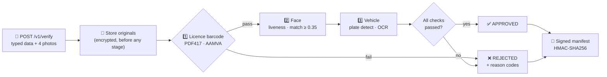

<div align="center">

# 🪪 Komüte-Local

### Offline driver &amp; vehicle verification node — one request in, one decision out

**Licence barcode · Face match · Licence plate · Signed audit trail**


</div>

---

Komüte-Local verifies a new driver for the main Komüte application. The app sends the driver's typed details and **four photos**; the node answers **`APPROVED`** or **`REJECTED`** with machine-readable reason codes. There is no human review step and nothing leaves the machine: every model runs locally on the CPU.

> [!IMPORTANT]
> **Status: pre-production.** Built and tested end to end on three real Canadian licences plus large synthetic and public benchmarks. Before production it still needs a liveness model, face-threshold confirmation on real selfie–licence pairs, and a memory measurement on Linux. See [Known limits](#%EF%B8%8F-known-limits).

## 📑 Contents

- [Highlights](#-highlights)
- [How a verification works](#-how-a-verification-works)
- [Quick start](#-quick-start)
- [API at a glance](#-api-at-a-glance)
- [Testing with Postman](#-testing-with-postman)
- [Measured results](#-measured-results)
- [Models](#-models)
- [Configuration](#%EF%B8%8F-configuration)
- [Security and privacy](#%EF%B8%8F-security-and-privacy)
- [Project layout](#%EF%B8%8F-project-layout)
- [Known limits](#%EF%B8%8F-known-limits)
- [Documentation](#-documentation)

## ✨ Highlights

| | |
|---|---|
| 🔒 **Fully offline** | Four ONNX models on CPU. No cloud call, no GPU, no external service at verification time. |
| ⚖️ **Two outcomes only** | `APPROVED` or `REJECTED`. Every failed check is listed, each marked **retryable** (a better photo can fix it) or **final**. |
| 🪪 **Barcode is the truth** | The AAMVA PDF417 on the licence back is decoded and every typed field is checked against it. |
| 🙂 **Face match** | Selfie vs. licence photo with YuNet + ArcFace (`w600k_r50`). Pass mark 0.35, calibrated on AgeDB-30. |
| 🚗 **Plate check** | YOLOv9-tiny finds the plate, a 10-slot OCR reads it, one optical confusion (O/0, I/1, B/8) is tolerated. |
| 🧾 **Tamper-evident audit** | Images encrypted with AES-256-GCM; every session gets a SHA-256 manifest signed with HMAC-SHA256. |
| 🧠 **Small footprint** | Steady 334 MB, peak 383 MB RAM on Windows; one verification in about 1.4 s. |
| 🇨🇦 **13 jurisdictions** | All Canadian provinces and territories, identified by their official AAMVA issuer numbers. |

## 🔄 How a verification works



| Stage | What it checks | Typical reason codes |
|---|---|---|
| **1 · Licence barcode** | Decodes the PDF417 on the licence back. Province = issuer; name (fuzzy, 90% pass); date of birth, licence number, class, issue and expiry dates (exact). Not expired, issue date not in the future, age 18+. **A failure here stops the run.** | `BARCODE_UNREADABLE` (retry), `NAME_MISMATCH`, `DOB_MISMATCH`, `LICENCE_EXPIRED`, `UNDERAGE` |
| **2 · Face** | Finds and aligns the face in the selfie and on the licence front; single-photo liveness; cosine similarity of 512-d embeddings. | `FACE_NOT_FOUND_SELFIE` (retry), `LIVENESS_FAILED` (retry), `FACE_MISMATCH` |
| **3 · Vehicle** | Finds and reads the plate, compares it to the typed plate. Body colour is advisory only. | `PLATE_NOT_FOUND` (retry), `PLATE_MISMATCH` |
| **Audit** | Compressed copies, face and plate crops, signed manifest. Rejected-session images deleted within 72 h; approved originals after 30 days. | — |

A crash or a failed model load returns an **error, never a decision** — and never `APPROVED`.

## 🚀 Quick start

```bash
git clone https://github.com/jassu-Workspace/komute-verification-node.git
cd komute-verification-node
```

<details open>
<summary><b>🪟 Windows laptop (development and testing)</b></summary>

Needs x64 Windows 10 1809+ / Server 2019+, 2 GB RAM, 3 GB free disk.

```powershell
powershell -ExecutionPolicy Bypass -File .\setup.ps1   # once: VC++ runtime, uv, Python 3.12, packages, models (SHA-256 checked), dev keys, tests
powershell -ExecutionPolicy Bypass -File .\run.ps1     # checks everything, starts http://127.0.0.1:8000, opens the test page
```

| `run.ps1` option | Effect |
|---|---|
| `-Port 8010` | Use another port |
| `-NoBrowser` | Do not open the browser |
| `-WithApiKey` | Require `X-API-Key` (this machine's key in `%LOCALAPPDATA%\komute\dev.env`) |
| `-ApiKey <key>` | Require this key (24+ characters), e.g. the shared test key for Postman |
| `-CheckOnly` | Run the checks, do not start |

Full procedure: [Windows setup guide (PDF)](docs/guides/Window%27s%20setup%20guide.pdf)
</details>

<details>
<summary><b>🐧 Ubuntu server (22.04 / 24.04, x86_64, 2 GB RAM or more)</b></summary>

```bash
sudo bash ./setup.sh                 # packages, user "komute", Python 3.12, requirements.lock, models, /etc/komute/komute.env, systemd service
sudo systemctl status komute         # the service runs ./start.sh and starts at boot
journalctl -u komute -f              # live log
curl http://127.0.0.1:8000/health    # {"status":"ok", ...}
```

| Path | Contents |
|---|---|
| `/opt/komute/app` | Code and models |
| `/opt/komute/venv` | Python 3.12 environment |
| `/etc/komute/komute.env` | Settings and secrets (`root:komute`, `0640`) |
| `/var/lib/komute/storage` | Encrypted sessions (only user `komute`) |

Authentication is **on** for the server (a random key is generated once). Read it with `sudo grep ^KOMUTE_API_KEY= /etc/komute/komute.env`.
Full procedure and the integration contract: [Linux server guide (PDF)](docs/guides/Linux%20Server%20guide.pdf)
</details>

<details>
<summary><b>🛠️ Manual (any shell)</b></summary>

```bash
uv python install 3.12
uv venv --python 3.12 "$LOCALAPPDATA/komute/venv"
uv pip install --python "$LOCALAPPDATA/komute/venv" -r requirements.lock
python scripts/make_dev_keys.py && source scripts/dev_env.sh
KOMUTE_DEV_SKIP_LIVENESS=true "$PY" -m uvicorn backend.app.main:create_app --factory --workers 1
"$PY" -m pytest -m "not samples"     # 353 unit and API tests, about 1 minute
```

Keep `--workers 1`: the node runs one verification at a time by design.
</details>

## 🔌 API at a glance

| Endpoint | Purpose |
|---|---|
| `POST /v1/verify` | Run one verification (`multipart/form-data`) |
| `GET /v1/sessions/{request_id}` | Read a finished result again |
| `GET /health` | Readiness: `200` ready, `503` not ready (no key needed) |
| `GET /v1/system` | Live system monitor (browser page or JSON) |
| `GET /` | Test page with a decoded-barcode popup |

**Request fields**

| Field | Rule |
|---|---|
| `request_id`, `driver_id` | Letters, digits, `-`, `_`; up to 64 characters |
| `consent_at`, `consent_policy_version` | Required. ISO-8601 time **with** a time zone |
| `claimed.full_name`, `claimed.date_of_birth`, `claimed.licence_number`, `claimed.issuing_province`, `claimed.licence_class`, `claimed.issue_date`, `claimed.expiry_date` | Dates `YYYY-MM-DD`; province `ON QC BC AB MB SK NB NS NL PE YT NT NU` |
| `claimed.plate_number`, `claimed.vehicle_colour` | Colour is advisory |
| `claimed.vehicle_make`, `claimed.vehicle_model`, `claimed.vehicle_year` | Optional, stored only |
| `selfie`, `licence_front`, `licence_back`, `vehicle` | JPEG, PNG or WebP, ≤ 10 MB each, sent as binary parts |

<details>
<summary><b>Example request (Python)</b></summary>

```python
import requests

fields = {
    "request_id": "req-1001", "driver_id": "drv-42",
    "consent_at": "2026-11-11T12:00:00-05:00", "consent_policy_version": "v1",
    "claimed.full_name": "Alex Tester", "claimed.date_of_birth": "1990-03-15",
    "claimed.licence_number": "T1234-56789-01234", "claimed.issuing_province": "ON",
    "claimed.licence_class": "G", "claimed.issue_date": "2023-09-14", "claimed.expiry_date": "2030-12-31",
    "claimed.plate_number": "ABC 123", "claimed.vehicle_colour": "Grey",
}
with open("selfie.jpg", "rb") as s, open("front.jpg", "rb") as f, open("back.jpg", "rb") as b, open("car.jpg", "rb") as v:
    r = requests.post(f"{BASE_URL}/v1/verify", headers={"X-API-Key": API_KEY}, data=fields,
                      files={"selfie": s, "licence_front": f, "licence_back": b, "vehicle": v}, timeout=(3, 30))
print(r.json()["decision"])   # "APPROVED" or "REJECTED"
```
</details>

<details>
<summary><b>Example response</b></summary>

```json
{
  "request_id": "req-1001",
  "decision": "REJECTED",
  "reasons": [
    { "code": "BARCODE_UNREADABLE", "retryable": true,
      "message": "The barcode on the back of your licence is not clearly visible. Please retake the photo of the barcode." }
  ],
  "stages": { "barcode": { "ran": true, "readable": false }, "face": { "ran": false }, "vehicle": { "ran": false } },
  "advisories": [],
  "timings_ms": { "total": 2210.4, "barcode": 2100.0, "face": 0.0, "vehicle": 0.0 },
  "rss_mb": 318.5,
  "audit": { "manifest_id": "aa11…", "key_id": "m1" }
}
```
</details>

| HTTP | Meaning |
|---|---|
| `200` | A decision was made — read `decision` |
| `401` | Missing or wrong `X-API-Key` (authentication on) |
| `409` | Same `request_id` reused with different data |
| `422` | Bad input: `MISSING_FIELD`, `INVALID_FIELD`, `CONSENT_REQUIRED`, `INVALID_IMAGE`, `IMAGE_TOO_LARGE` |
| `503` | Busy — one verification at a time; wait `Retry-After` |
| `500` | Engine fault — **not** a rejection |

The complete contract for the main application: [`docs/INTEGRATION_GUIDE.md`](docs/INTEGRATION_GUIDE.md).

## 🧪 Testing with Postman

The [`postman/`](postman/README.md) folder holds **33 requests in 7 folders**, each with automatic tests, plus fake samples (a fake Ontario licence with a real AAMVA barcode).

1. Start the node: `.\run.ps1 -NoBrowser` (authentication off) or `.\run.ps1 -NoBrowser -ApiKey komute-local-TEST-key-not-for-production`.
2. Import the collection and the matching environment: **Komute Local** or **Komute Local (auth on)**.
3. Set Postman's working directory to the `postman/` folder, then **Run collection**.

Expected: **33 requests, 0 failures** (Newman with the test key: 180 assertions, 0 failures).

```bash
npx --yes newman@6 run postman/Komute-Local.postman_collection.json -e postman/Komute-Local.postman_environment.json --working-dir postman
```

> [!WARNING]
> `komute-local-TEST-key-not-for-production` is a shared key for **local test machines only**. Never use it on a networked server or in production.

Tester guide: [Postman testing guide (PDF)](docs/guides/komute-local-postman-testing.pdf)

## 📊 Measured results

All numbers below were measured on this codebase; reports and scripts are linked.

| Area | Data set | Result |
|---|---|---|
| **End to end** | 3 real licences (NS, ON, SK), 54 live API requests | **54/54** expected results, every signed record valid — [report (PDF)](docs/guides/komute-local-live-results.pdf) |
| **Barcode** | 650 synthetic licence backs, 13 jurisdictions, phone-style degradations | **85.2%** pass Stage 1 (554/650); wrong names rejected 100% — [report](docs/calibration/barcode-synthetic.md) |
| **Plate** | OpenALPR US end-to-end set, 222 photos | Plate found **99.5%**, exact read **87.4%**, passes the plate rule **88.7%** — [report](docs/calibration/plate-openalpr-us.md) · [PDF](docs/calibration/plate-benchmark-report.pdf) |
| **Face** | AgeDB-30, 6,000 pairs ~30 years apart | **98.03%** standard 10-fold accuracy; at 0.35: **0 of 3,000** wrong people accepted, 14.6% same-person rejects — [report](docs/calibration/face-agedb30.md) · [PDF](docs/calibration/face-benchmark-report.pdf) |
| **Memory & speed** | 50 runs on 3 real cards (Windows) | Steady **334 MB**, peak **383 MB**, p50 **1.43 s**, p95 **1.85 s** |

<details>
<summary><b>Face threshold trade-off on AgeDB-30</b> (3,000 same-person and 3,000 different-person pairs)</summary>

| Threshold | Same person rejected | Different people accepted |
|---|---|---|
| 0.25 | 147 (4.9%) | 2 |
| 0.30 | 253 (8.4%) | 0 |
| **0.35 (current)** | **439 (14.6%)** | **0** |
| 0.40 (previous) | 776 (25.9%) | 0 |
| 0.45 | 1,304 (43.5%) | 0 |

AgeDB pairs are about 30 years apart; licence-to-selfie gaps are usually under 10 years, so real rejects should be lower. 3,000 impostor pairs bound the false-accept rate only to about 0.12%; proving the 0.01% target needs about 30,000.
</details>

<details>
<summary><b>Fine-tuning experiment (not adopted)</b></summary>

`w600k_r50` was fine-tuned on CACD (163,446 photos, 2,000 people) on 2× T4 with DDP, fp16, partial freezing and teacher distillation ([notebook](training/finetune_w600k_kaggle.ipynb)). It did **not** improve: AgeDB-30 accuracy 98.03% → 97.82%. The original model stays.
</details>

## 🧠 Models

| Role | File | Size |
|---|---|---|
| Face detection + 5 landmarks | `face_detection_yunet_2023mar.onnx` (YuNet) | 0.2 MB |
| Face embedding (512-d) | `w600k_r50.onnx` (InsightFace ArcFace R50) | 166 MB |
| Plate detection | `yolo-v9-t-384-license-plates-end2end.onnx` (YOLOv9-tiny) | 7.4 MB |
| Plate OCR | `cct_xs_v2_global.onnx` (fast-plate-ocr CCT-XS) | 3.2 MB |
| Liveness | *not supplied yet* (candidate: MiniFASNet) | — |

Model files are not stored in git. The setup scripts download them and **reject any file whose SHA-256 differs** from [`backend/models/models.lock`](backend/models/models.lock); the engine refuses to start on a mismatch.

## ⚙️ Configuration

Settings come from environment variables (`KOMUTE_*`) or a git-ignored `.env`; see [`.env.example`](.env.example) for every option.

| Setting | Default | Meaning |
|---|---|---|
| `KOMUTE_ENV` | `dev` | `production` requires a liveness model and an API key of 24+ characters |
| `KOMUTE_API_KEY` | empty | Empty = no authentication (local testing only) |
| `KOMUTE_FACE_MATCH_THRESHOLD` | `0.35` | Face pass mark (cosine similarity) |
| `KOMUTE_NAME_MATCH_THRESHOLD` | `90` | Name fuzzy-match pass mark (%) |
| `KOMUTE_MIN_AGE` | `18` | Minimum age from the barcode date of birth |
| `KOMUTE_MAX_UPLOAD_BYTES` | `10000000` | Per-image upload limit |
| `KOMUTE_REJECTED_IMAGES_TTL_H` | `72` | Delete rejected-session images after this many hours |
| `KOMUTE_APPROVED_ORIGINALS_TTL_D` | `30` | Delete approved-session originals after this many days |

## 🛡️ Security and privacy

- **Encryption at rest:** AES-256-GCM for every stored image and record; keys are injected through the environment, never committed.
- **Signed audit trail:** SHA-256 per file and an HMAC-SHA256-signed manifest per session, with a key id for rotation.
- **Retention:** rejected-session images deleted within 72 hours; approved originals after 30 days; image-free audit records are kept.
- **Least privilege on Linux:** a dedicated `komute` system user and a hardened systemd unit (`ProtectSystem=strict`, `NoNewPrivileges`, `MemoryMax=1300M`).
- **Network:** the node listens on `127.0.0.1` by default. Do not expose port 8000 to the internet; use a TLS reverse proxy if the main app runs on another server.
- **Personal data:** real licence images are never stored in this repository; responses and logs carry no secrets.

## 🗂️ Project layout

```text
backend/
  core/          verification engine (no web dependencies): stages, gates, matching, audit, models
  app/           FastAPI wrapper: routes, auth, errors, run gate
  static/        test page (index.html) and system monitor (stats.html)
  models/        models.lock (SHA-256 of each ONNX file)
storage/         encrypted blob store, crypto, retention sweeper
scripts/         benchmarks, evaluation, key and sample generators
tests/           353 unit and API tests, plus real-sample end-to-end tests
postman/         Postman collection, environments and fake samples
training/        Kaggle fine-tuning notebook (experiment)
docs/            architecture, specifications, integration guide, calibration reports, PDF guides
setup.ps1 · run.ps1      Windows setup and start
setup.sh  · start.sh     Ubuntu setup and start (systemd service "komute")
```

## ⚠️ Known limits

- **No liveness model yet.** The node cannot detect a printed photo or a screen; dev runs report `LIVENESS_SKIPPED_DEV`, and production mode refuses to start without one. Single-photo liveness is weaker than multi-frame.
- **Face threshold not proven on real selfies.** 0.35 comes from a public celebrity data set; confirm it on real licence–selfie pairs.
- **The plate stage proves that a car with that plate was photographed**, not that the car belongs to the driver.
- **Linux memory is not measured yet** (Windows: 334 MB steady, 383 MB peak).
- **Suspension and revocation are out of scope** — the main application queries provincial driver records.
- **TLS is not set up by the scripts.**

## 📚 Documentation

| Topic | Document |
|---|---|
| Setup guides (PDF) | [Windows](docs/guides/Window%27s%20setup%20guide.pdf) · [Linux server + integration](docs/guides/Linux%20Server%20guide.pdf) · [Postman testing](docs/guides/komute-local-postman-testing.pdf) · [Live results](docs/guides/komute-local-live-results.pdf) |
| Integration contract | [INTEGRATION_GUIDE.md](docs/INTEGRATION_GUIDE.md) |
| Architecture | [ARCHITECTURE.md](docs/ARCHITECTURE.md) |
| Stage specifications | [Barcode](docs/STAGE1_BARCODE_SPECIFICATION.md) · [Face](docs/STAGE2_BIOMETRICS_SPECIFICATION.md) · [Vehicle](docs/STAGE3_ALPR_SPECIFICATION.md) |
| Storage | [STORAGE_SPECIFICATION.md](docs/STORAGE_SPECIFICATION.md) |
| Models | [MODELS_SPECIFICATION.md](docs/MODELS_SPECIFICATION.md) · [MODEL_FACTS.md](docs/MODEL_FACTS.md) |
| Operations | [DEPLOYMENT_AND_OPERATIONS.md](docs/DEPLOYMENT_AND_OPERATIONS.md) |
| Test page | [FRONTEND_ELEMENTS_SPECIFICATION.md](docs/FRONTEND_ELEMENTS_SPECIFICATION.md) |
| What is proven and what is not | [ACCEPTANCE_REPORT.md](docs/ACCEPTANCE_REPORT.md) |
| Benchmarks | [docs/calibration/](docs/calibration/) |

---

<div align="center">
<sub>Komüte-Local · offline verification for the Komüte platform · 13 Canadian jurisdictions</sub>
</div>
